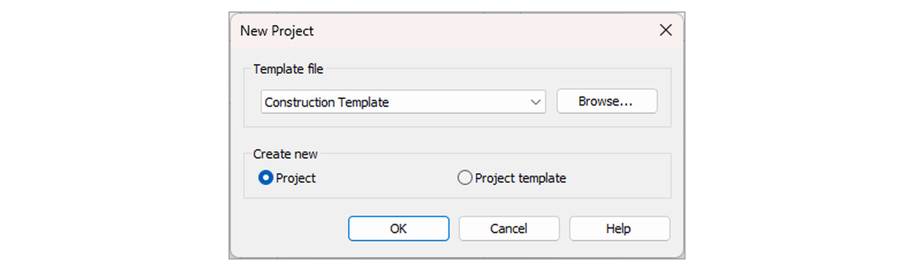
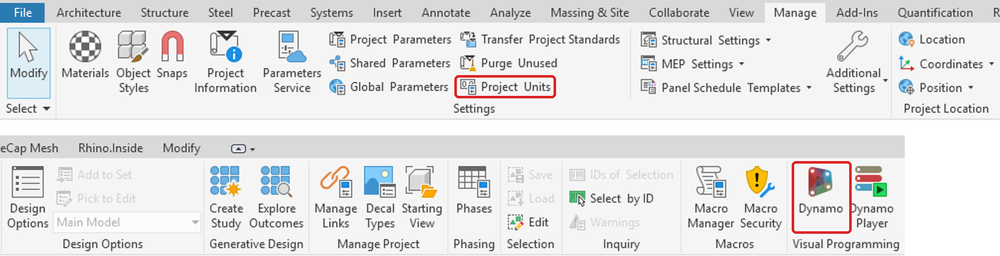
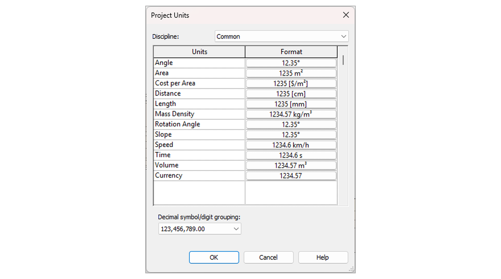

# Chapter 3 Worked Examples: Revit and Dynamo

These are step-by-step solutions to the worked examples in Chapter 3 of *Digital Underground Engineering*.

| Folder | Content |
|---|---|
| [`Worked_Example_5`](Worked_Example_5) | Assembling a mined station complex (shafts, cross-passages and cavern runs) from parameters |
| [`Worked_Example_6`](Worked_Example_6) | Installing rock bolts on the cavern crown parametrically |

**Software:** Autodesk Revit with Dynamo (Manage tab) and a metric project template. The graphs use only standard Dynamo nodes (number sliders, Code Blocks, Watch nodes and Revit DirectShapes), so no packages need to be installed.

> **Version:** The examples were created in Revit 2025 (with Dynamo 3.0). Revit files cannot be opened in an earlier version, so you need **Revit 2025 or later** to open them.

## Set up Revit and Dynamo

Start every example from a new metric project, so that old geometry does not mix with new.

1. Open Revit. On the Home screen, under **Models**, click **New...**. Keep the default template, choose **Project**, and click **OK**.

   

2. Open the **Manage** tab and click **Project Units**. In step 3 you will also use **Dynamo** on this tab. Both buttons are marked in red below.

   

   Check that **Length** is in **mm**, then close the dialog.

   

3. Still on the **Manage** tab, click **Dynamo** in the Visual Programming panel. Dynamo opens in its own window after a few seconds.

4. On the Dynamo start page, click **Open** and select the graph (`.dyn` file) in the folder of the example. When Dynamo asks **Open external file?**, click **Yes**.

5. Leave the run mode at **Manual** (bottom left). Nothing is sent to Revit until you click **Run**.

> **Why the project units matter:** Dynamo works in the length unit of the Revit project. The graphs take their inputs in metres and multiply every length by k = 1000 to give millimetres. In a project set to metres, change k to 1 in the **Units** Code Block.
