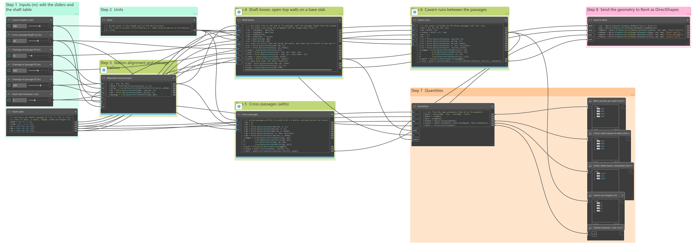
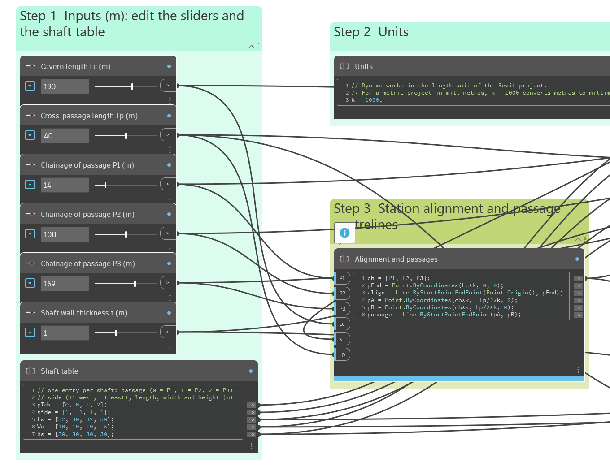
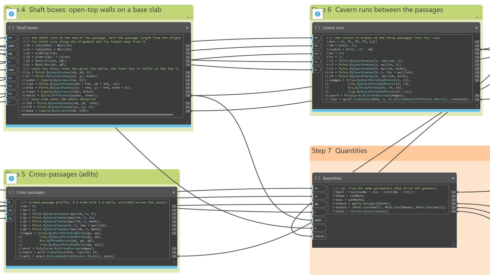
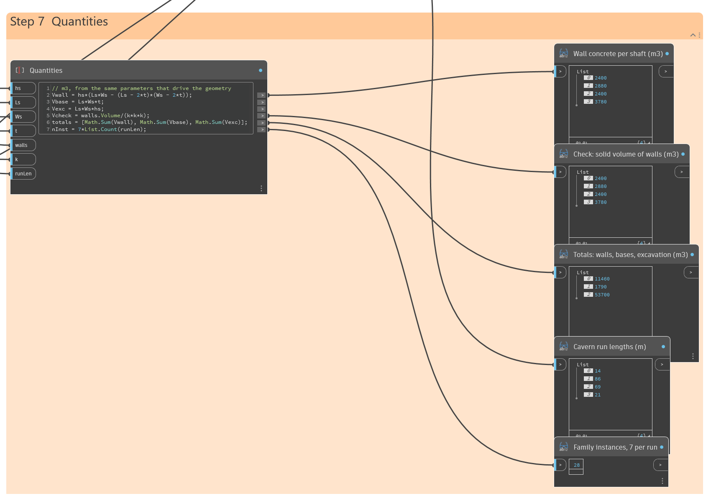
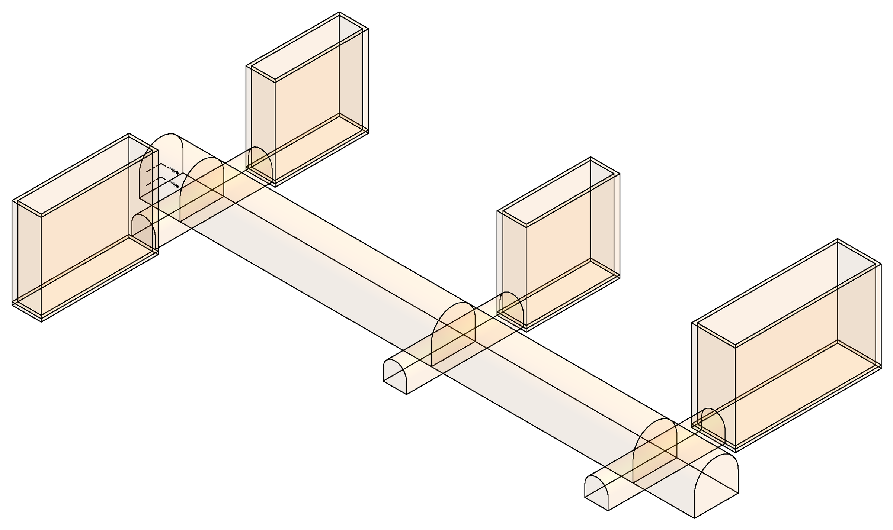
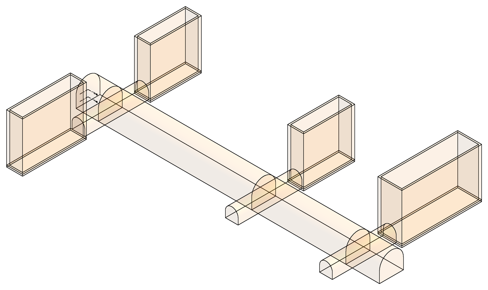
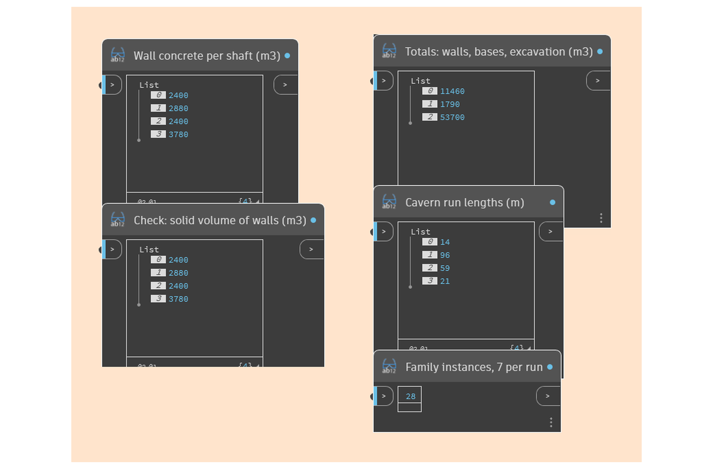

# Worked Example 5: Assembling the station complex

The graph builds four shafts, three cross-passages and four cavern runs from six sliders and one table. It then reports the wall concrete per shaft as 2,400, 2,880, 2,400 and 3,780 m³.

| File | Content |
|---|---|
| `WE5_station_assembly.dyn` | The Dynamo graph |

Set up Revit and Dynamo as described in the [Chapter 3 setup guide](../README.md), then open `WE5_station_assembly.dyn`. The graph reads left to right in eight coloured groups.

*The whole graph: inputs on the left, Revit output on the right.*

## Read the graph, step by step

1. **Step 1 Inputs.** The sliders hold the cavern length (190 m), the cross-passage length (40 m), the chainages of passages P1, P2 and P3 (14, 100 and 169 m) and the shaft wall thickness (1 m). The **Shaft table** Code Block lists one entry per shaft: its passage, its side (+1 west, −1 east) and its length, width and height. Each row of the table is one shaft.
2. **Step 2 Units.** `k = 1000` converts metres to millimetres (see the setup guide).
3. **Step 3 Alignment and passages.** A line from 0 to 190 m along x is the station alignment. Each passage centreline runs across it, from −Lp/2 to +Lp/2 at its chainage.

   

   *Steps 1 to 3: sliders, the shaft table and the alignment block.*

4. **Step 4 Shaft boxes.** Each shaft sits at the end of its passage. An outer cuboid minus an inner cuboid gives the walls; the inner box is taller, so the top stays open. A base slab sits under the footprint.
5. **Step 5 Cross-passages.** An arched profile, 8 m wide with 4 m walls, is extruded across the cavern at each chainage.
6. **Step 6 Cavern runs.** The chainages split the 190 m cavern into four runs. A 15 m wide arched profile is extruded along each run.

   

   *Steps 4 to 6: shafts, cross-passages and cavern runs.*

7. **Step 7 Quantities.** The same parameters give the volumes by formula. **Check: solid volume of walls** measures the geometry itself, and it should match the formula.

   

   *Step 7: the quantities after the first run.*

8. **Step 8 Send to Revit.** `DirectShape.ByGeometry` turns each solid into a Generic Model element in the project.

The wall concrete of one shaft, with external dimensions L × W, height h and wall thickness t, is:

$$V_{wall} = h\left[L\,W-(L-2t)(W-2t)\right]$$

## Run it and check

1. Click **Run**. The status bar should read **Run completed**, with no warnings.
2. Compare the Watch nodes with these values:

   | Watch node | Expected value |
   |---|---|
   | Wall concrete per shaft (m³) | 2,400 · 2,880 · 2,400 · 3,780 |
   | Check: solid volume of walls (m³) | same as above |
   | Totals: walls, bases, excavation (m³) | 11,460 · 1,790 · 53,700 |
   | Cavern run lengths (m) | 14 · 86 · 69 · 21 |
   | Family instances, 7 per run | 28 |

3. Switch to Revit. In the Project Browser, expand **3D Views** and double-click **{3D}**. Type **ZA** to zoom to fit.

   

   *Revit 3D view after the first run: four shafts, three passages, four cavern runs.*

## Change one number and watch it regenerate

1. Back in Dynamo, click the value box of **Chainage of passage P2 (m)**, type **110** and press Enter.
2. Click **Run**. The P2 shaft and passage move 10 m along the alignment, and the cavern runs either side are rebuilt.

   

   *Revit 3D view after moving P2 to 110 m.*

3. Check **Cavern run lengths**: 14, 96, 59 and 21 m. The shaft quantities do not change, because only the position of the shaft changed.

   

   *Watch nodes after the change: new run lengths, same shaft quantities.*

4. Set P2 back to **100** and run again.
