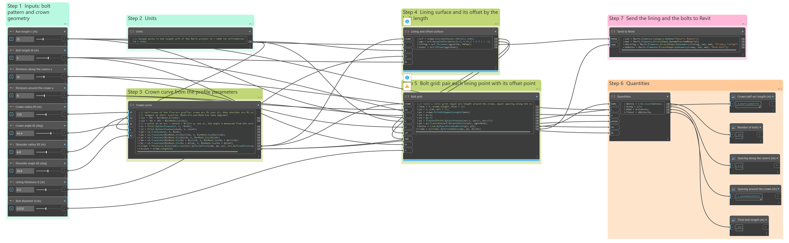
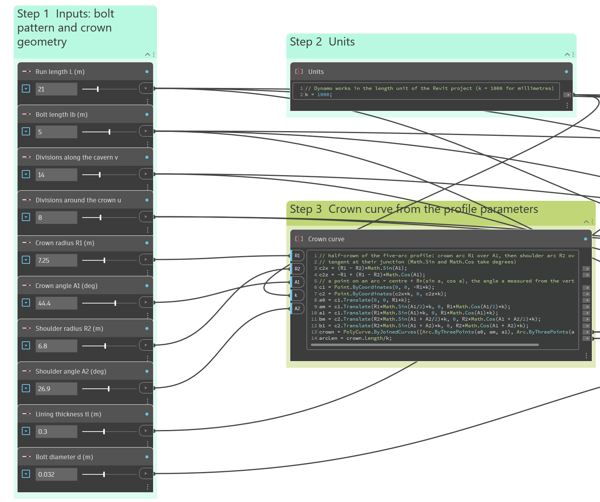
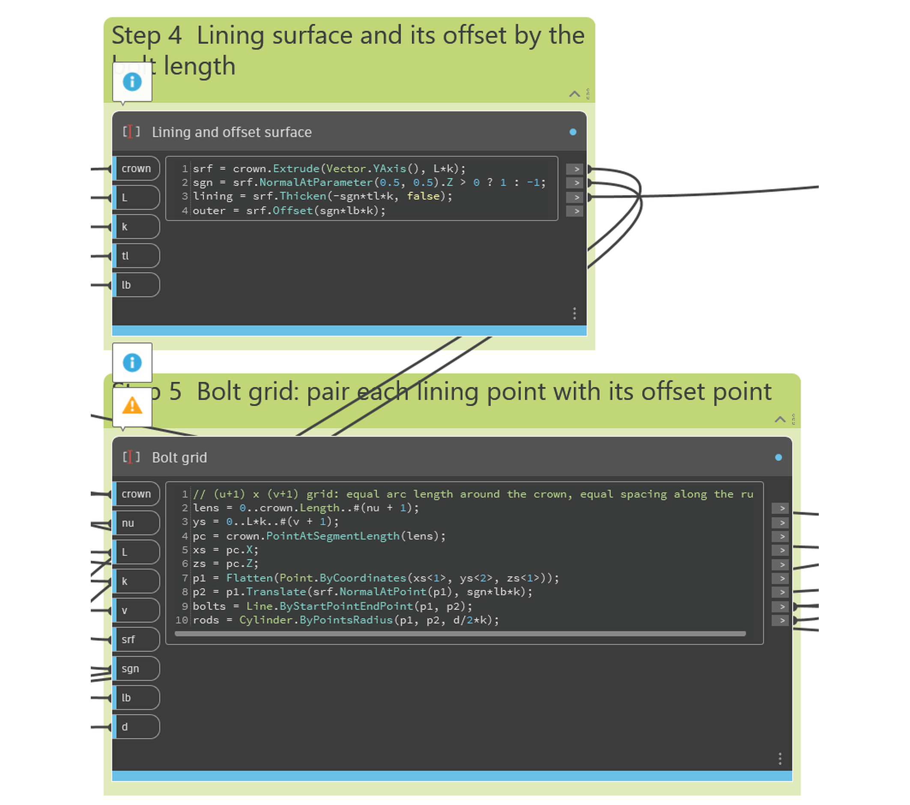
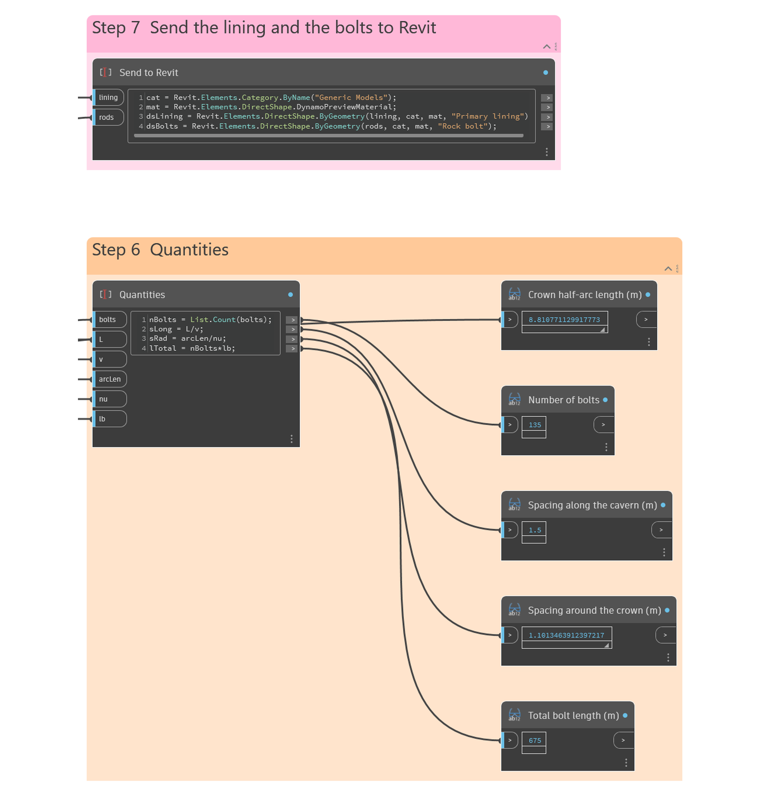
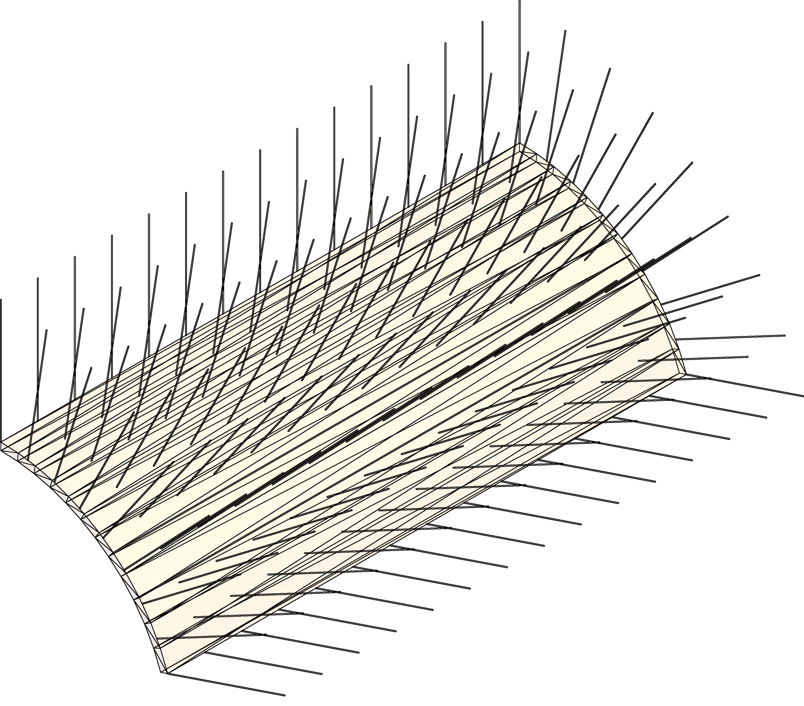
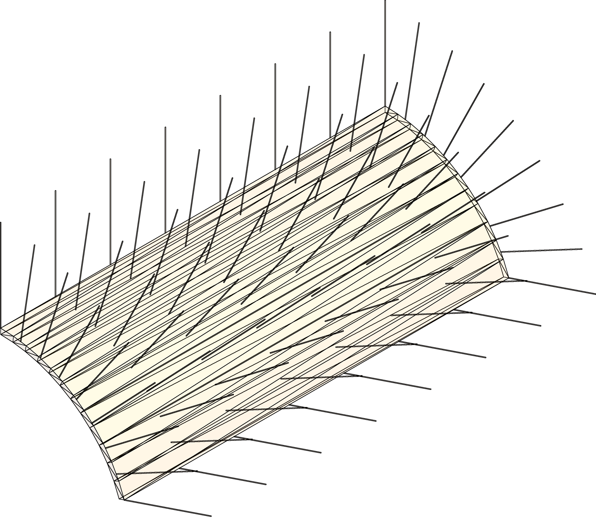
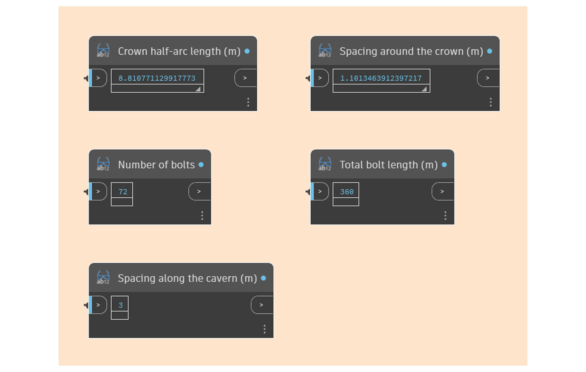

# Worked Example 6: Installing the crown support

The graph places 135 rock bolts, 5 m long, on a 21 m run of the cavern crown, at 1.5 m along the cavern and 1.1 m around the crown.

| File | Content |
|---|---|
| `WE6_rock_bolts.dyn` | The Dynamo graph |

Start a new project and open Dynamo as described in the [Chapter 3 setup guide](../README.md) (steps 1 to 4), then open `WE6_rock_bolts.dyn`.

*The whole graph.*

## Read the graph, step by step

1. **Step 1 Inputs.** The bolt pattern is the run length L (21 m), the bolt length lb (5 m), the divisions along the cavern v (14) and around the crown u (8). The crown is the crown arc R1 = 7.25 m over A1 = 44.4° and the shoulder arc R2 = 6.8 m over A2 = 26.9° of the five-arc profile in Chapter 3. The last two sliders set the lining thickness and the bolt diameter.
2. **Step 2 Units.** `k = 1000`, as in the setup guide.
3. **Step 3 Crown curve.** Each arc point is centre + R · (sin a, cos a), with the angle a measured from the vertical. The shoulder centre C2 lies on the radius through the end of the crown arc, so the two arcs meet tangentially. Dynamo's `Math.Sin` and `Math.Cos` take degrees.

   

   *Steps 1 to 3: inputs and the crown curve.*

4. **Step 4 Lining and offset surface.** The crown curve is extruded along the tunnel (y) by L to give the lining surface. Offsetting it by the bolt length gives the surface where the bolts end.
5. **Step 5 Bolt grid.** Points are placed at equal arc length around the crown (u + 1 of them) and at equal spacing along the run (v + 1). Each point is moved along the surface normal by lb, and a bolt (a cylinder) joins the two points.

   

   *Steps 4 and 5: lining, offset surface and the bolt grid.*

6. **Step 6 Quantities.** The number of bolts, the two spacings and the total bolt length.
7. **Step 7 Send to Revit.** The lining and the 135 bolts become DirectShapes.

   

   *Steps 6 and 7: quantities and the Revit output.*

The pattern follows from the parameters:

$$n=(u+1)(v+1),\qquad s_{along}=\frac{L}{v},\qquad s_{around}=\frac{W}{u}$$

Here W is the curved width of the crown, 8.81 m for these arcs.

## Run it and check

1. Click **Run** (it takes up to a minute, because 135 bolts are created). The status bar should read **Run completed**.
2. Compare the Watch nodes with these values:

   | Watch node | Expected value |
   |---|---|
   | Crown half-arc length (m) | 8.81 |
   | Number of bolts | 135 |
   | Spacing along the cavern (m) | 1.50 |
   | Spacing around the crown (m) | 1.10 |
   | Total bolt length (m) | 675 |

3. In Revit, open **{3D}** and type **ZA**. The bolts stand normal to the lining: vertical at the crown, turning towards horizontal at the shoulder.

   

   *Revit 3D view: lining and 135 bolts.*

## Change one number and watch it regenerate

1. Set **Divisions along the cavern v** to **7** and click **Run**.
2. The bolts rebuild in 8 rows instead of 15. The Watch nodes read 72 bolts, 3.0 m spacing along the cavern and 360 m in total, while the spacing around the crown stays 1.10 m.

   

   *Revit 3D view with v = 7.*

   

   *Watch nodes with v = 7.*

3. Set v back to **14** and run again.
